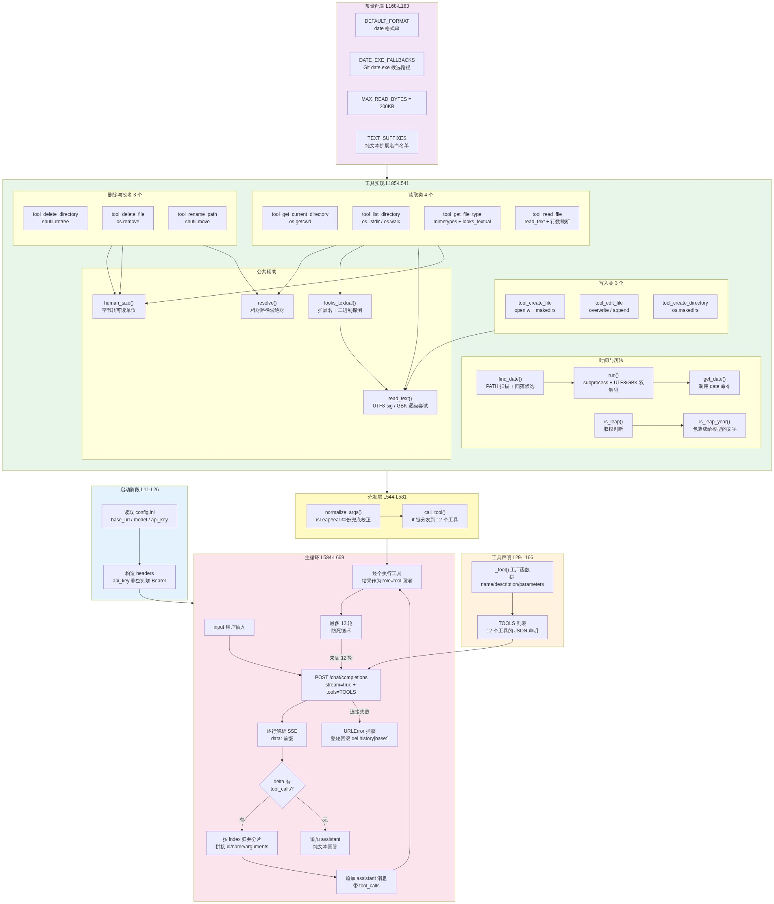

# LLM 应用开发课程作业

九次课的动手作业，一个目录一次任务。

- **PetHospitalMCP** —— 宠爱AI病历管理系统：Go 后端存病历，Python MCP 服务器把它包装成工具给 AI 调用。
- **AnythingLLMMCP** —— 把 AnythingLLM 工作区的检索问答接成 MCP 工具。
- **AnythingLLMServer** —— 单文件网页上传文档，让 AnythingLLM 完成向量化。
- **Agent/Practice01** —— `chat.py`，和大模型循环对话：流式打字机输出，每轮把全部聊天记录发给模型。
- **Agent/Practice02** —— `chat.py`，在 Practice01 基础上加 function call：模型自己决定调工具，共 12 个函数。
- **Agent/xAgent** —— 把 Practice02 改造成 `core` + `tui` 两层：业务逻辑不依赖界面，终端界面用 Textual；再加联网、命令行和技能加载能力，共 16 个工具。

Practice01 / Practice02 用法：复制 `config.example.ini` 为 `config.ini`，填自己的接口地址、模型名、密钥，然后 `python chat.py`。

Practice02 的工具故意用两种实现方式对照：`getDate` 走 `subprocess` 调本地 `date` 命令（Windows 没有取时间的 Python 内置接口），其余 11 个都是纯 Python 实现。

xAgent 用法：同样复制 `config.example.ini` 为 `config.ini`，然后 `python main.py`。它的 `core/` 不导入 textual 或任何界面框架，将来加 Web / Desktop 版只需再写一个界面层。

xAgent 的联网工具还需要在 `config.ini` 里配一个 `[search]` 小节，填百度千帆的 API Key，`searchWeb` 才能用。`fetchWeb` 依赖 `trafilatura`，没装会给出安装提示，不影响其余工具。

## Practice02 的工具清单

时间与历法：

- `getDate` —— 调本地 `date` 命令取当前日期时间，可传格式化串。
- `isLeapYear` —— 取模判断闰年，不传年份时用本机当前年份。

本地文件操作（10 个）：

- `getCurrentDirectory` —— 取当前工作目录的绝对路径。
- `listDirectory` —— 列出目录内容，标出文件/目录和大小，可选递归。
- `getFileType` —— 按扩展名给出类型名、MIME，并判断是否纯文本。
- `readFile` —— 读纯文本文件内容，默认最多 200 行，支持 UTF-8 和 GBK。
- `createFile` —— 新建文本文件并写初始内容，已存在时默认不覆盖。
- `editFile` —— 修改已有文件，`overwrite` 整体替换、`append` 追加末尾。
- `createDirectory` —— 建目录，父目录自动创建。
- `deleteDirectory` —— 删目录，非空也连内容一起删。
- `deleteFile` —— 删单个文件。
- `renamePath` —— 重命名或移动文件、目录。

## xAgent 的工具清单

比 Practice02 多四个工具，共 16 个。前 12 个与上面相同，另外四个是：

- `searchWeb` —— 调百度千帆 AI 搜索，返回搜索摘要和参考来源的标题、链接、站点、时间。API Key 从 `config.ini` 的 `[search]` 小节读 `baidu_qianfan_api_key`，不在代码里硬编码。
- `fetchWeb` —— 用 `subprocess` 调本地 `curl` 抓网页 HTML，再用 `trafilatura` 提取正文转 Markdown。保留标题、段落、列表、表格、链接，去掉导航栏、广告、页脚。curl 走参数列表方式，不用 `shell=True`。
- `RunCli` —— 在本机执行任意命令行程序。接收 `command`（程序名）和 `args`（参数数组），用 `subprocess.run([程序名] + 参数, shell=False)` 执行，返回退出码、标准输出、标准错误。默认 30 秒超时，输出超过 4000 字符会截断并标明原始长度。
- `loadSkill` —— 按需加载某个技能的完整说明或它引用的附件文件。只传 `name` 返回 `SKILL.md` 全文，同时传 `filename` 读附件。读取范围严格限制在该技能目录内部。

这几个工具都把错误转成给模型看的文本，不抛异常打断对话：缺 Key、Key 是占位符、HTTP 401/403/429/5xx、网络不可达、超时、域名解析失败、JS 渲染页提取不到正文、HTML 解析失败、正文超长截断、程序不存在、参数类型不对、技能不存在、路径越权，各有对应的清晰提示。

## xAgent 的 Agent Skills

按 Agent Skills 规范实现技能动态加载。

技能放在**项目根**（程序启动时的工作目录）的 `.agents/skills/<技能名>/SKILL.md`：

```
D:\LLM\
└─ .agents\skills\
   ├─ notice\SKILL.md             撰写通知
   └─ zodiac-fortune\
      ├─ SKILL.md                 星座运势解读
      └─ references\
         └─ detailed-rules.md     附件：详细规则
```

`SKILL.md` 开头用 YAML Frontmatter 声明 `name` 和 `description`，两个字段都必需。

**加载分两步，正文不占启动上下文**：

1. **启动时**只读 `name` 和 `description`，拼成清单注入 System Prompt
2. **模型需要时**调 `loadSkill` 把正文拉进对话

这样技能正文写多长都不影响启动，只在真正用到时才消耗 token。

## xAgent 的分层

```
Agent/xAgent/
├─ main.py        入口，--tools 列工具，--check 自检
├─ core/          业务逻辑，只依赖标准库（trafilatura / yaml 白名单例外）
│  ├─ agent.py    Agent 类，用 6 个回调通知界面
│  ├─ config.py   配置读取，支持 [search] 小节
│  ├─ skills.py   技能发现、System Prompt 注入、按需加载
│  ├─ llm/        流式请求与 tool_calls 分片归并
│  └─ tools/      16 个工具
├─ tui/           Textual 界面，只做显示和输入
└─ interfaces/    界面契约，说明新界面要实现哪 6 个回调
```

分层的硬约束由 `_test_layers.py` 用 AST 检查保证：`core/` 不许导入 textual 等界面库，`tui/` 不许碰网络和文件。

## 架构图

`Agent/Practice02/chat-stream-tool-fileOps.mmd` 是这个程序的 Mermaid 架构图，把启动、工具声明、常量配置、工具实现、分发、主循环六层画在一起。

渲染效果：



图片是 `chat-stream-tool-fileOps.mmd` 用 <https://mermaid.live> 渲染后导出的。想改图就改 `.mmd` 文件，再把内容贴到 mermaid.live 重新导出。

## 文件命名

`Agent/Practice02` 下按课程推进保留了几个阶段的快照：

- `chat-stream-tool-getDate.py` —— 只有 `getDate` 一个工具。
- `chat-stream-tool-isLeapYear.py` —— 加上 `isLeapYear`。
- `chat-stream-tool-fileOps.py` —— 加上 10 个文件操作工具，是当前完整版。
- `chat.py` —— 与 `chat-stream-tool-fileOps.py` 内容一致，`启动本地模型.bat` 跑的是它。
